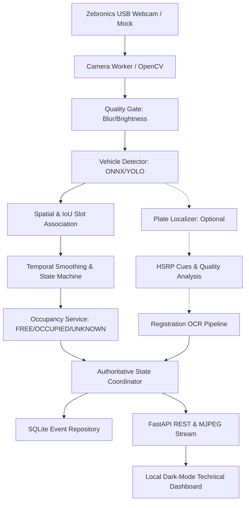

# System Architecture & Layer Boundaries

The **Smart Parking Management & HSRP-Style Recognition System** is structured as a decoupled, multi-tiered pipeline engineered for high-availability occupancy monitoring.

## Layer Boundaries & Separation of Concerns

1. **Presentation (`web/`)**: Offline-bundled dark UI with SVG icons, live MJPEG canvas, interactive polygon calibration editor, real-time metrics, and diagnostic triggers. Never accesses database or computer vision directly.
2. **API & Endpoints (`app/api/`)**: Thin FastAPI routes handling HTTP requests, input validation via Pydantic, and MJPEG frame streaming.
3. **Application & Orchestration (`app/services/`, `app/application/`)**: State coordinator acting as the single authoritative source of truth for slot states, active camera health, and metrics.
4. **Computer Vision & Processing (`app/camera/`, `app/detection/`, `app/parking/`, `app/plates/`, `app/ocr/`)**:
   - `camera`: Dedicated worker owning the video capture loop, managing buffers, stale frames, and reconnection.
   - `detection`: Vehicle bounding box inference.
   - `parking`: Geometry and state machine (`FREE`, `OCCUPIED`, `UNKNOWN`).
   - `plates`: Plate crop localization and visual HSRP-style cue inspection.
   - `ocr`: Character normalization and format validation.
5. **Persistence (`app/database/`)**: Thread-safe SQLite repository with automated schema versioning, retention pruning, and privacy masking.
6. **Diagnostics & Self-Tests (`app/diagnostics/`)**: In-app test runner producing JSON and Markdown verification reports across three testing tiers.
7. **Infrastructure (`app/infrastructure/`, `app/config/`)**: Central configuration parser, structured rotating logger, and OS/hardware detection.

## The Independence Principle
Occupancy detection operates autonomously from plate reading. If plate detection or OCR fails or is disabled, occupancy state transitions (`FREE` <-> `OCCUPIED`) remain fully operational. OCR success is never a prerequisite for parking occupancy.
